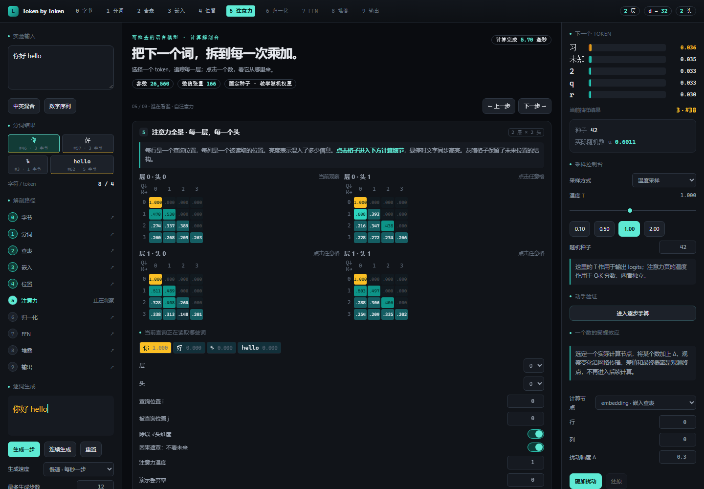

# Token by Token · 语言模型解剖台

一个纯前端、中文界面的 Transformer 实验台。输入文字，从 UTF-8 字节一路追踪到下一 token 的概率；点击矩阵结果，查看它对应的输入行、权重列、每一项乘积与总和。

- 在线使用：https://kevinmasai.github.io/token-by-token/
- 技术栈：**Vite + React 18 + TypeScript strict**。所有计算、训练和数据都在浏览器中。
- 不使用 UI 组件库、Tailwind、深度学习运行库、自动微分或分词器库。
- 默认模型和 BPE 规则内置，首次打开页面后，计算不依赖网络、后端或 API key。



## 启动

需要 Node.js **22.12+ 或 24+**，推荐 Node.js 24 LTS。

```bash
git clone https://github.com/KevinMaSAI/token-by-token.git
cd token-by-token
npm install
npm run dev
```

打开终端显示的本地地址。开发默认绑定 `127.0.0.1`。

```bash
npm test                # Vitest 数值、模型、分词、梯度、干预与模型导入测试
npm run build           # TypeScript strict 检查 + 静态构建
npm run preview         # 查看生产构建
npx playwright install chromium
npm run test:e2e        # 独立 Chromium 浏览器中的完整交互测试
```

`dist/` 可以部署到任何静态服务器。Web Worker 使用 ES module，因此请通过 HTTP/HTTPS 打开；不要双击 `index.html` 使用 file://。

本仓库的 GitHub Pages 从 `main` 分支的 `docs/` 发布。修改源码后执行 `npm run build` 和 `node scripts/publish_static.mjs`，再提交并推送更新后的 `docs/`；GitHub Actions 会运行测试，Pages 会自动重新部署。

## 怎么玩

1. 输入「你好 hello」，在顶部依次选择 0–9 的任一阶段。顶部展示十个阶段；生成循环作为第 10 阶段放在左栏和时间线。
2. 在「分词」点击慢速合并，暂停后手动选择另一组合法相邻符号，比较 token ID。
3. 在「注意力」选择层、头、查询位置，依次展开 Q/K/V、Q·K、softmax、加权求和和输出投影。
4. 点击矩阵结果格，查看完整乘加。所有矩阵共享 `MatrixView / MatMulView / FormulaView`，不会用动画代替算式。
5. 点击「进入逐步手算」，或展开底部「查看任意张量 / 单元格干预」，把某一数改掉，再从该节点继续计算。右栏显示真实概率差值。
6. 点击「生成一步」或连续生成。每个时间线节点保存输入 ID、完整前向状态、采样设置、概率和实际随机数；点击可恢复，再生成会从此处分支。
7. 点击「训练一个模型」，运行默认 500 步。训练完成自动应用参数，可导出 JSON，稍后重新导入。

## 三种模型来源

### ① 默认微型模型：零下载

| 配置 | 数值 |
|---|---:|
| 词表大小 | 64 |
| Transformer 层数 | 2 |
| 注意力头数 | 2 |
| 模型维度 d | 32 |
| FFN 存储宽度 | 64 |
| 最大上下文 | 32 |
| 总存储参数数（包含对照用参数） | 26,560 |

随机种子为 42。矩阵参数使用稀疏的 **0.125 × {-1, 0, 1, 2}**，归一化的 γ 初始为 1，β 和偏置为 0。这些是**教学时固定种子随机初始化权重，没有经过预训练**，不能把其生成文本或相似度解释成语言知识。位置表和 SwiGLU 门参数在对应模式未启用时不参与计算。

手写的 64 项模型词表在界面完整可见。256 项可逆字节映射是分词器的符号字母表，**不是 256 项模型词表**。最终 BPE 片段不在 64 项词表时使用 `<unk>`（ID 0），原始片段和字节范围仍保留。空输入使用 `<bos>`。

### ② 浏览器训练：真实参数更新

独立 `train.worker.ts` 对完整两层 Transformer 执行交叉熵训练。Q/K/V、输出投影、两层 FFN、归一化参数、嵌入和启用的门/位置参数均有显式反向传播。实现手写 Adam、偏差修正和全局梯度范数裁剪，没有计算图或自动微分。

内置 14 条短句，包括中文、英文和数字。训练固定使用内置英文优先 BPE，结构采用点击开始时的实验设置。每步发送真实损失、梯度范数、裁剪后范数与嵌入矩阵快照。暂停在训练步边界生效并应用已训练参数；再次开始保留参数、重置 Adam 动量。

默认 500 步已在 Chromium 中运行验证。速度与设备、当前打开的视图有关，不能保证所有设备上 60fps 或固定训练时长。训练损失下降表示记住这个小语料，不代表获得通用语言能力。

### ③ 可选预训练模型：导出和导入接口

应用默认**不附带预训练权重**。本次交付没有运行 Hugging Face 模型下载和 Python 转换（当前环境未安装转换所需的 PyTorch/Transformers），因此不把这个接口称为经过真实 checkpoint 数值对齐验证的推理器。导入校验、格式往返、缺失文件降级已测试。

```bash
python -m pip install torch transformers huggingface_hub
python scripts/export_weights.py \
  --model sshleifer/tiny-gpt2 \
  --revision main \
  --out public/models
npm run dev
```

建议把 `--revision` 改为模型仓库的固定提交 SHA。脚本产生：

- `config.json`：配置、原始 GPT-2 byte BPE 词表与合并表、正确的默认前向选项。
- `weights.json`：从原始模型抽取的 Float32 权重。
- `model.json`：可直接通过界面导入的完整文件。
- `reference.json`：独立 PyTorch 模型对 `hello world` 的 token ID 和 logits，供进一步对齐检查。

Python 仅是离线格式转换工具；这些库不会进入网页。前端的分词、注意力、RoPE、归一化、FFN 和输出投影始终使用手写 TypeScript。

导出器只支持**小型 GPT-2 架构**，不假装支持架构不同的 Pythia/Qwen。浏览器检查上限为 d≤128、FFN≤512、12 层、128 token 上下文、词表≤65,536、存储参数≤16M。`sshleifer/tiny-gpt2` 是极小公开检查点，适合验证格式，不代表高质量生成能力；其原始位置编码是 learned，每头一维，RoPE 对照无可旋转维度对。修改位置/激活/归一化选项属于架构干预，将不再复现原始模型。

文件缺失、服务器返回 HTML、非法维度、NaN/Infinity 或 15 秒读取超时都会给出中文提示，并保留已有模型。**网络受限时使用 ① 和 ②，两种模式均不需要外部权重。**

## 阶段与真实 LLM 数学对应

所有向量使用行向量约定。`X` 为 `序列长度 × 模型维度`，线性层统一写为 `XW+b`，避免把行向量与列向量公式混用。

| 阶段 | 真实原理 | 可检查内容 |
|---|---|---|
| 0 字节 | Unicode → UTF-8 | 字符对应字节、十六进制、字节到可打印字符的双射 |
| 1 分词 | byte-level BPE | 每轮全部相邻对、rank、边界限制、手动合并、前后序列 |
| 2 查表 | token → 离散 ID | 可搜索的完整词表、输入所用 ID、UNK 逻辑 |
| 3 嵌入 | `X[i]=E[id_i]` | 完整嵌入矩阵、余弦相似度、单维修改 |
| 4 位置 | `q'=R(pos)q, k'=R(pos)k` | 每头维度对、单位圆、角度、旋转前后；sinusoidal/learned/none 对照 |
| 5 注意力 | `softmax(QKᵀ/√d + mask)V` | 每层每头全景、Q/K/V、每个点积、稳定 softmax、加权求和、拼接和 WO |
| 6 归一化 | 残差加法与 `(x−μ)/√(var+ε)·γ+β` | 每维残差、均值求和、方差求和、γ/β；RMSNorm、pre/post-LN 对照 |
| 7 FFN | `σ(XW1+b1)W2+b2` | 两次矩阵乘法、激活前后、ReLU/GELU/SiLU/SwiGLU、有效隐藏宽度 |
| 8 堆叠 | 多层残差流 | 层形状、范数、每个位置的 `x_out−x_in` 差值探针 |
| 9 输出 | 最终归一化 → `XW_vocab+b` → softmax → sample | 全词表 logits、÷T、减 max、指数、概率、截断、随机数、温度对照 |
| 10 生成 | 自回归 token ID 追加 | 单步/连续、上限、结束标记、完整时间线回放、两组采样配置对比 |

稳定 softmax 使用 `exp(z_i−max(z)) / Σ exp(z_j−max(z))`。Top-k / Top-p 都先选择保留集合再重新归一化。随机数使用固定种子的 Mulberry32；每个生成步骤有确定的种子派生值。Greedy 直接选择最大 logit，不需要概率参与决策。

RoPE 按**每头维度**成对旋转，`q_i'·k_j'` 依赖相对位置角度。取消显式位置编码并不保证完全丢失顺序：因果遮罩本身仍携带前缀结构；同时去掉遮罩与位置后才有此处测试的置换等变性。关闭遮罩让早期位置看到未来输入，会破坏自回归训练条件，但不能声称每一次推理的质量必定变差。

pre-LN / post-LN 对照是对同一权重进行两次真实前向运算，不用一次前向结果冒充深层训练稳定性证据。调窄 FFN 会把超出有效宽度的激活置零，保持矩阵形状以便对照。演示 dropout 使用固定掩码并按 `1/(1-p)` 缩放；正常推理默认关闭。

## 数值、界面与计算边界

- 所有模型权重和中间张量都是 `Float32Array`，不是预置截图、硬编码概率或动画。累加使用 JavaScript number，写入张量时按 Float32 舍入。
- 每个阶段的计算有明确检查点。干预值在该节点被消费，再计算下游；扰动实验同时重新运行基线以给出差值。`delta` 与最终概率是观测终点，不误称它们是上游输入。
- 所有重型前向、BPE、采样与训练在 Worker 中；主线程只负责交互、轻量视图数据整理与绘制。矩阵按行分页，大词表还按列分页，任意单元格仍可选。
- 统一 `format.ts` 固定小数、千位分隔、等宽字体和表格数字；算式显示值舍入，真实计算使用未舍入输入，因此最后一位可能和手加显示数字略有差异。
- 色值仅定义在 `src/styles/tokens.css`。遵循三栏深色布局与指定组件类，无阴影、玻璃效果、数值入场动画或 UI 库。数值同时用符号和正负背景区分。
- 页面不会保存用户输入到服务器，也不发送分析或追踪请求。训练权重默认仅留在内存，刷新会重置；请用导出功能保存。
- 生成采用完整前向重算，不使用 KV cache，便于检查每一步。超过上下文时保留最后 N 个 token，并明确显示截断情况；位置编号从当前窗口 0 重新计算。

## 测试覆盖与验证范围

`tests/*.test.ts` 覆盖：

- byte-to-unicode 256 字节可逆、混合中英文预期 token、合并可复现与边界规则。
- matmul 对照独立三重循环（误差 < 1e-6）、稳定 softmax、LayerNorm 均值/方差。
- RoPE 保范数、相对位置余弦关系；因果遮罩未来权重严格为 0。
- 固定种子采样、Top-p 截断后重新归一化。
- 两层网络多个参数组的手写梯度，使用中心有限差分加 Richardson 外推，**绝对误差 < 1e-5**；包括 pre/post-LN、GELU 与 SwiGLU。
- 全网络真实训练能降低损失、全局范数裁剪、干预路径传播、无位置无遮罩的置换等变性。
- JSON 往返与不合法权重拒绝。

`tests/e2e/` 在独立 Chromium 中验证十阶段、慢速合并、嵌入修改、注意力遮罩、完整乘加、生成与时间线分支、手算干预、两组采样、空输入/表情、50 步和 500 步训练、JSON 导出再导入、离线推理、390px 布局、缺失模型降级。

未声称验证所有浏览器/真实手机，未执行预训练检查点端到端对齐，也没有宣称任何设备都能恒定达到 60fps。

## 目录

```text
token-by-token/
├─ src/
│  ├─ core/
│  │  ├─ tokenizer/{byteEncoder,bpe,merges}.ts
│  │  ├─ model/{config,weights,embedding,attention,normalization,ffn,layer,forward,train,load}.ts
│  │  ├─ tensor.ts  ops.ts  sample.ts  format.ts
│  ├─ workers/{compute,train}.worker.ts
│  ├─ components/
│  │  ├─ MatrixView.tsx  MatMulView.tsx  FormulaView.tsx
│  │  ├─ StageBytes.tsx  StageBPE.tsx  StageLookup.tsx  StageEmbedding.tsx
│  │  ├─ StagePosEnc.tsx  StageAttention.tsx  StageLayerNorm.tsx
│  │  ├─ StageFFN.tsx  StageResidual.tsx  StageOutput.tsx
│  │  ├─ ManualCompute.tsx  Perturbation.tsx  TensorInspector.tsx
│  │  ├─ TrainingPanel.tsx  Comparison.tsx  Timeline.tsx
│  │  └─ ParamConsole.tsx  ProbPanel.tsx  TokenBar.tsx  GenText.tsx  Shared.tsx
│  ├─ state/store.ts
│  ├─ styles/{tokens,base,components}.css
│  └─ App.tsx  main.tsx
├─ tests/                 # Vitest + Playwright
├─ scripts/export_weights.py
├─ public/models/README.md
├─ docs/                  # GitHub Pages 静态发布与预览图
├─ index.html
├─ package.json  package-lock.json
├─ tsconfig.json  vite.config.ts  playwright.config.ts
└─ README.md
```

## 数学与格式参考

- [Attention Is All You Need](https://arxiv.org/abs/1706.03762)：缩放点积注意力与 Transformer。
- [RoFormer](https://arxiv.org/abs/2104.09864)：旋转位置编码与相对位置。
- [Hugging Face GPT-2 原始实现](https://github.com/huggingface/transformers/blob/main/src/transformers/models/gpt2/modeling_gpt2.py)：导出器的参数布局、pre-LN 与 GELU 对齐依据。
- [sshleifer/tiny-gpt2 原始模型页](https://huggingface.co/sshleifer/tiny-gpt2)：可选极小检查点的来源。

本项目的前向、反向、BPE 和数值展示代码均独立手写；参考链接不是浏览器运行时依赖。
